  

# 🤖 Awesome AI Virtual Companion & Anime Voice Agents 🎙️

  
  
  
  
  
  

---

## 🌟 Top AI Virtual Companion & Anime Voice Agents Ecosystem

> A curated collection of leading **SaaS platforms**, **open-source desktop & mobile apps**, **AI VTuber frameworks**, **Live2D/VRM avatar pipelines**, and **real-time voice conversational agents**.

**Keywords / SEO**: *AI Companion, Virtual Companion, Anime Voice Agents, AI VTuber, Neuro-sama, SillyTavern, Live2D Avatars, VRM Avatars, Real-Time Voice Chat, GPT-SoVITS, Pipecat, Character Chatbots, Local LLM Roleplay, Speech-to-Speech Agents.*

---

## 📑 Table of Contents

- [📊 Sector Overview & Market Dynamics](#-sector-overview--market-dynamics)
- [🏢 SaaS & Hosted Platforms](#-saas--hosted-platforms)
- [💻 Open-Source GitHub Projects](#-open-source-github-projects)
- [🛠️ Frameworks & Architecture for Custom Builds](#️-frameworks--architecture-for-custom-builds)
- [🤝 How to Contribute](#-how-to-contribute)
- [💖 Support & Sponsorship](#-support--sponsorship)
- [📈 Star History](#-star-history)
- [⚠️ Disclaimer](#️-disclaimer)

---

## 📊 Sector Overview & Market Dynamics

The global AI companion and digital emotional companion market is estimated at approximately **$30 billion to $45 billion**, with research forecasts projecting continuous growth exceeding **$150 billion by the mid-2030s** (expanding at an estimated CAGR of 25–31%). 

The sector displays a **concentrated head with a highly fragmented tail**: the top echelon of well-funded platforms (such as MiniMax's Talkie, Chai AI, Character.ai, and Replika) captures roughly 85–90% of aggregate category revenue and active user hours due to substantial compute and low-latency infrastructure demands. Concurrently, an agile long-tail of open-source frameworks, uncensored roleplay web front-ends, desktop pet companions, and indie VTuber agents is rapidly expanding to give users complete data privacy, self-hosted autonomy, and custom fine-tuned voice capabilities.

---

## 🏢 SaaS & Hosted Platforms

| Company / Product | Description | Company Size (Valuation / Revenue) | Pricing (Starting Tier) | Free Tier Limits |
| :--- | :--- | :--- | :--- | :--- |
| **[Talkie AI](https://www.talkie-ai.com/)** | 💬 Character and voice-oriented companion experiences with animated avatars and chat (developed by MiniMax). | **~$11.5B–$25B Valuation** (MiniMax HKEX IPO; >$100M+ revenue) | **$9.99/mo** (Talkie+ Standard; Pro at $24.99/mo) | **Free forever plan**: Unlimited standard chat with daily stamina/interaction quotas; access to standard voice and basic character creation. |
| **[Chai AI](https://chai.ml/)** | 📱 Mobile-first character chat app with a large catalog of bots and rapid conversational UX (Chai Research). | **~$2.4B Valuation** ($100M+ ARR) | **$9.99/week** (~$159.99/yr; Chai Max at $90/mo) | **Free forever plan**: Ad-supported access with limited daily message/token allotments per refresh cycle; free 24-hour Pro trial. |
| **[Character.ai](https://character.ai/)** | 🎭 Large-scale character chat platform with community-created personas, group chats, and voice features. | **~$1B Peak Valuation** (~$5M+/mo revenue run-rate) | **$4.99/mo** (c.ai Lite; flagship c.ai+ at $9.99/mo) | **Free forever plan**: Unlimited text messaging on free models; subject to waiting rooms/queues and standard response speeds during peak hours. |
| **[Replika](https://replika.com/)** | ❤️ Long-running AI companion focused on emotional support, memory, and relationship-style conversations (Luka, Inc.). | **~$11M Raised** (~$5M–$15M ARR estimate) | **$19.99/mo** ($69.99/yr, Replika Pro) | **Free forever plan**: Basic text chat with standard conversational model; voice calls, relationship statuses, and advanced AI modes require Pro. |
| **[Crushon.ai](https://crushon.ai/)** | 🔥 Uncensored-leaning character chat platform popular for roleplay and adult-oriented companion experiences. | **~$3M–$10M ARR (Est.)** (Independent/Private) | **$5.99/mo** (Standard tier; $4.91/mo billed annually) | **Free forever plan**: Unlimited chats on basic free models plus 100 bonus Pro credits/month; 8K context memory; chats prune after 7 days inactivity. |
| **[Kindroid](https://kindroid.ai/)** | 🧠 Highly customizable AI companions with deep long-term memory, voice, and selfie/avatar generation. | **~$2M–$8M ARR (Est.)** (Independent/Private) | **$13.99/mo** (Web starting tier; $15.99/mo in-app) | **Free trial only**: One-time trial of 50 messages on flagship model upon sign-up; transitions to read-only once depleted without a paid subscription. |
| **[Botify AI](https://botify.ai/)** | 🤖 Character and companion-oriented chat platform emphasizing personality and ongoing engagement (Ex-Human). | **~$2M–$5M ARR (Est.)** ($29.99/yr consumer pricing) | **$29.99/yr** (Breakdown: ~$2.50/mo equivalent) | **Free forever plan**: Ad-supported messaging with daily energy token caps and cooldown periods; basic avatars and community bots. |
| **[Anima AI](https://anima.ai/)** | 🌸 Virtual companion app centered on conversation, mood tracking, and relationship-style interaction (Apperry). | **~$1M–$3M ARR (Est.)** (Independent/Private) | **$9.99/mo** ($39.99/yr, Anima Pro) | **Free forever plan**: Unlimited basic "Friend Mode" text chat; voice calls, deep roleplay, and romantic relationship features are locked. |
| **[Kajiwoto](https://kajiwoto.com/)** | 🐾 AI companion and character creation tools with chat and customization focused on personal adoption. | **~$500K–$2M ARR (Est.)** (Independent/Bootstrapped) | **$7.99/mo** (Plus tier; Pro at $29.99/mo) | **Free forever plan**: Unlimited messages capped at 400 chars/msg, 1 personal room (max 2 AIs), 2K context, and 10 memory saves per room. |
| **[Paradot](https://www.paradot.ai/)** | 🌐 AI companion with persistent memory, personality traits, and multimodal interaction features (WithFeeling.AI). | **Early-stage / Seed** (Independent/Bootstrapped) | **$9.99/mo** ($39.99/yr, Paradot Pro) | **Free forever plan**: Daily chat quota replenished via daily logins/check-ins; photo sharing and specialized Dating Space hubs require Pro. |

---

## 💻 Open-Source GitHub Projects

*Sorted in descending order by GitHub Stars ⭐.*

- **[Open WebUI](https://github.com/open-webui/open-webui)**   
  🌐 Feature-rich, self-hosted web UI supporting Ollama, OpenAI-compatible APIs, pipelines, and voice integration, functioning as an extensible foundation for personal companion bots.

- **[GPT-SoVITS](https://github.com/RVC-Boss/GPT-SoVITS)**   
  🔊 State-of-the-art 1-minute few-shot voice cloning and text-to-speech synthesis engine powering custom anime character voices and expressive voice companions.

- **[Project AIRI](https://github.com/moeru-ai/airi)**   
  💖🧸 Self-hosted, you-owned AI companion & VTuber stack inspired by Neuro-sama—features real-time voice chat, Live2D/VRM avatar movement, desktop/web clients, and agent gaming capabilities (Minecraft, Factorio).

- **[Text Generation WebUI](https://github.com/oobabooga/text-generation-webui)**   
  🎛️ The definitive local LLM workbench featuring character chat modes, prompt presets, lorebooks, and extension APIs for private companion setups.

- **[SillyTavern](https://github.com/SillyTavern/SillyTavern)**   
  🍺 Power-user roleplay and character chat front end supporting PNG character cards, lorebooks, world info, emotion expressions, TTS, and local/remote LLM backends.

- **[Pipecat](https://github.com/pipecat-ai/pipecat)**   
  🎙️ Production-grade open-source framework for ultra-low latency real-time voice agents, multimodal conversational pipelines, and WebRTC streaming.

- **[KoboldCpp](https://github.com/LostRuins/koboldcpp)**   
  ⚡ Lightweight, single-executable local GGUF model runner with built-in UI and OpenAI/Kobold-compatible endpoints, tailored for roleplay and SillyTavern integration.

- **[a16z Companion App](https://github.com/a16z-infra/companion-app)**   
  🧩 Open-source lightweight starter stack for creating and hosting personalized AI companions with persistent memory, vector storage, and voice personality.

- **[AI-Vtuber (Ikaros-521)](https://github.com/Ikaros-521/AI-Vtuber)**   
  📺 Virtual streamer framework powered by LLMs (ChatGPT, Claude, Ollama) and Live2D/VRM avatars with real-time live chat interaction on Bilibili, YouTube, and Twitch.

- **[Super Agent Party](https://github.com/heshengtao/super-agent-party)**   
  🎉 All-in-one AI companion platform combining self-hosted Neuro-sama architecture and open-agent tool execution for companion desktop setups.

- **[RisuAI](https://github.com/kwaroran/RisuAI)**   
  📖 Cross-platform modern roleplay client (Web, Desktop, Mobile) supporting advanced card scripts, customizable themes, and diverse backend engines.

- **[Soul of Waifu](https://github.com/jofizcd/Soul-of-Waifu)**   
  🌌 Desktop roleplay & AI companion application featuring interactive Live2D/VRM avatars, voice chat, and local LLM reasoning.

- **[AI-Waifu-Vtuber (ardha27)](https://github.com/ardha27/AI-Waifu-Vtuber)**   
  🎤 AI VTuber pipeline combining speech recognition, LLM reasoning, voice synthesis, and VTuber Studio / Live2D lip-sync for streaming.

- **[Agnai (Agnaistic)](https://github.com/agnaistic/agnai)**   
  👥 Multi-user and multi-bot character chat front end designed with scale, collaborative group chats, and flexible provider support.

- **[OpenAmika](https://github.com/zeekk0/OpenAmika)**   
  ✨ Open-source Live2D companion featuring real-time voice, long-term memory, and local Ollama or cloud OpenRouter brains.

- **[EchoBot](https://github.com/KdaiP/EchoBot)**   
  🦊 Live2D-capable anime AI companion combining roleplay immersion with agent task automation across web and chat channels.

- **[AITuber OnAir](https://github.com/shinshin86/aituber-onair)**   
  📡 TypeScript toolkit for building Neuro-sama-style AI VTubers and characters that chat, speak, remember, and react to live streaming audiences.

- **[here](https://github.com/xiangking/here)**   
  💻 Proactive desktop AI companion that lives on your screen, featuring character profiles, long-term memory, voice, and spontaneous check-ins.

- **[Project Vesi](https://github.com/arskqz/project-vesi)**   
  ❄️ Anime-focused fully local multimodal companion with VRM avatar integration, on-device speech processing, and local LLM reasoning.

- **[Anime AI Companion](https://github.com/rhedak/anime_ai_companion)**   
  🎨 Local browser-based anime character front end fronting coding agents (Claude Code, Cursor, Ollama) with approval cards and remote control.

- **[Hibiki](https://github.com/DSwebTEAM/Hibiki)**   
  🌸 Private, in-browser anime companion AI with emotional depth, memory, and a Character Studio; runs client-side with user API keys.

---

## 🛠️ Frameworks & Architecture for Custom Builds

Building a custom, fully owned anime companion or Neuro-sama-style setup typically involves chaining specialized modular components:

1. **Avatar & Visual Rendering Layer**:
   * **Live2D Cubism / Cubism Web SDK**: 2D animated expression and physics.
   * **VRM / Three.js / Babylon.js**: 3D interactive models with blend shapes and eye-tracking.
   * **VTube Studio / Warudo**: Desktop avatar motion-tracking bridges with WebSocket APIs.
2. **Cognitive Brain & Reasoning Layer**:
   * **Local Inference**: [KoboldCpp](https://github.com/LostRuins/koboldcpp), [Ollama](https://github.com/ollama/ollama), or vLLM running fine-tuned roleplay weights.
   * **Roleplay Front Ends**: [SillyTavern](https://github.com/SillyTavern/SillyTavern), [Project AIRI](https://github.com/moeru-ai/airi), or [RisuAI](https://github.com/kwaroran/RisuAI).
3. **Voice & Multimodal Conversational Layer**:
   * **Automated Speech Recognition (ASR)**: Whisper.cpp, Faster-Whisper.
   * **Text-to-Speech (TTS)**: [GPT-SoVITS](https://github.com/RVC-Boss/GPT-SoVITS), ChatTTS, Edge-TTS, or CosyVoice.
   * **Real-Time Orchestration**: [Pipecat](https://github.com/pipecat-ai/pipecat) for sub-second speech-to-speech loops with barge-in / interruption handling.

---

## 🤝 How to Contribute

Contributions are warmly welcomed! 💖

1. 🍴 **Fork the repo** to your GitHub account.
2. 🌿 **Create a feature branch** (`git checkout -b feature/add-new-companion`).
3. 📝 **Add/edit entries** in `README.md` (keep descriptions concise, objective, and accurately categorized).
4. 🚀 **Commit your changes** (`git commit -m "Add NewProject to open-source companion list"`).
5. 📤 **Push to the branch** (`git push origin feature/add-new-companion`).
6. 📬 **Open a Pull Request** with a brief summary of the project.

---

## 💖 Support & Sponsorship

If you find this curated directory useful for your research, builds, or roleplaying setups:

- ⭐ **Star this repository** to help others discover it!
- 🍴 **Fork and share** with the AI, VTuber, and developer communities.
- ☕ **Buy me a coffee / Become a sponsor**: Show your support on my [GitHub Sponsor Dashboard](https://github.com/sponsors/ishandutta2007)! Every contribution fuels further maintenance and curation of open-source AI projects.

---

## 📈 Star History

---

## ⚠️ Disclaimer

- This repository is a **community-curated showcase** and directory—it does not constitute an official endorsement of any listed service or software.
- AI companions, roleplay agents, and emotional chatbots process personal user inputs. Please review individual privacy statements, local data regulations, and safety guidelines before using or deploying these tools.

---

  <b>Built with ❤️ for creators, roleplayers, VTubers, and open-source AI advocates.</b> 
  <i>Keep AI companions expressive, creative, and user-owned.</i>

